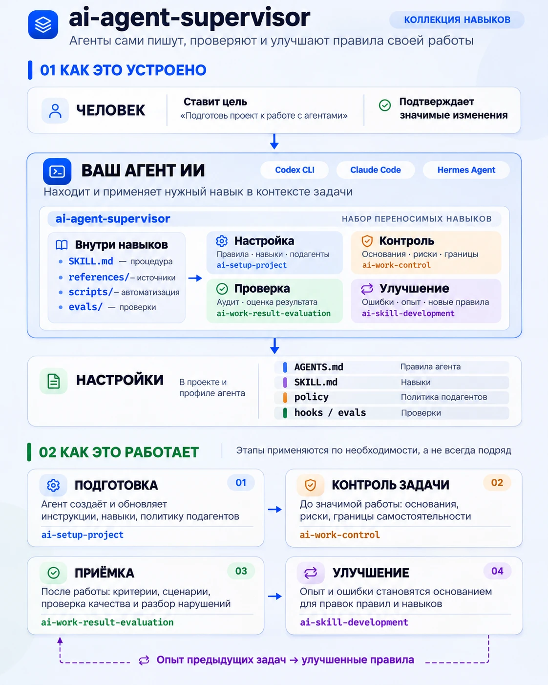

# Коллекция навыков для управления агентами ИИ

Главный принцип проекта: **«Человек должен получать желаемое, а не настраивать агентов».**

Агенты ИИ — мощный инструмент. Но качество выдаваемого ими результата, скорость работы и количество трудностей на пути к цели во многом зависят от правил, по которым действуют агенты. Создание хороших правил — отдельная работа, требующая специальных знаний.

Эта коллекция перекладывает настройку правил на самих агентов. Её навыки опираются на официальную документацию, передовые практики и другие знания, полезные для создания, проверки и улучшения правил агентов.

Коллекция помогает:

- создавать и улучшать `AGENTS.md` и другие правила для агентов;
- создавать и улучшать [навыки агентов](https://agentskills.io/);
- настраивать использование подагентов;
- разбирать ошибки агентов и предотвращать их повторение;
- создавать и развивать коллекции [APM](https://microsoft.github.io/apm/).



## Источники знаний

- [Anthropic Engineering](https://www.anthropic.com/engineering)
- [Документация Agent Package Manager для авторов](https://microsoft.github.io/apm/producer/)
- [Стандарт AI Safety Evaluation Standard](https://ukgovernmentbeis.github.io/as-evaluation-standard/)
- [Agent Skills](https://agentskills.io)
- [Microsoft Learn: evaluation flow for Prompt flow](https://learn.microsoft.com/en-us/azure/machine-learning/prompt-flow/how-to-develop-an-evaluation-flow)
- [Документация OpenAI Codex](https://developers.openai.com/codex)
- [Документация LangSmith](https://docs.langchain.com/langsmith)
- [Perplexity Research: Agent Skills](https://research.perplexity.ai/articles/designing-refining-and-maintaining-agent-skills-at-perplexity)
- [Документация Promptfoo](https://www.promptfoo.dev/docs/intro/)
- [Документация Visual Studio Code о пользовательских инструкциях](https://code.visualstudio.com/docs/agent-customization/custom-instructions)

<!-- compatibility-summary:start -->
## Поддерживаемые среды

Коллекцию можно установить в Codex CLI, Claude Code и Hermes Agent.

<!-- compatibility-summary:end -->


## Установка

### Hermes

[Подключите коллекцию и настройте Hermes](docs/hermes.md).
В руководстве описаны личный помощник без готового проекта и работа
с отдельным проектом, с областью действия каждого варианта.

### Claude Code и Codex CLI

Для установки потребуется [APM](https://microsoft.github.io/apm/) не ниже 0.29.1.

Подключите реестр коллекции:

```bash
apm marketplace add mekras/apm-marketplace --ref master
```

Выполните **в корне проекта** команду для используемого агента.

```bash
apm install ai-agent-supervisor@mekras#2.11.5 --target <цель>
```

`<цель>` — это `claude` для Claude Code или `codex` для Codex CLI.

Пример для Codex:

```bash
apm install ai-agent-supervisor@mekras#2.11.5 --target codex
```

### Настройка проекта

После установки для Claude Code или Codex CLI откройте проект в агенте
и попросите:

> Настрой этот проект для работы с агентами.

Или более однозначно:

> Выполни ai-setup-project.

### Необязательные зависимости

Некоторые навыки предлагают необязательные сценарии автоматизации. Они выполняют повторяемые проверки, экономят токены и делают результат стабильнее. Если для такого сценария нет нужного интерпретатора или среды, навык продолжит основной путь и сообщит, какую проверку не выполнил.

Для использования автоматизации рекомендуются Python 3 и совместимая с POSIX оболочка. Каждый навык отдельно указывает необходимые средства и ограничения.

## Обновление

Откройте в агенте проект, в который установили коллекцию, и попросите:

```text
Обнови ai-agent-supervisor до последнего выпуска в этом проекте и выполни ai-setup-project.
```

Для личного помощника Hermes [обновите коллекцию в том же профиле](docs/hermes.md#обновите-коллекцию).


## Использование

Кроме описанной выше первичной настройки проекта обычно никаких особых действий не требуется. Агенты сами будут применять подходящий навык там, где надо.

Ниже описаны некоторые возможности, а также перечислены все навыки коллекции.

- [Самообучение](https://github.com/mekras/ai-agent-supervisor/blob/master/Документация/Самообучение.md)

### Обучение

Агент может использовать опыт выполненных задач для улучшения навыков.
Разбор запускается вручную или автоматически после настройки. Изменение
навыков требует вашего разрешения.
[Как разобрать задачу, включить и выключить автоматическое обучение](.apm/skills/ai-skill-development/README.md#обучение).

### Навыки

#### [ai-agents-md-maintenance](.apm/skills/ai-agents-md-maintenance/README.md)

Обслуживает `AGENTS.md` и связанные инструкции для агентов.

Примеры запросов:

```
Создай AGENTS.md.
```

```
Оптимизируй AGENTS.md.
```

#### [ai-audit-agent-rules](.apm/skills/ai-audit-agent-rules/README.md)

Проверяет правила работы агента в одном источнике, связанном наборе или всей
системе: применимость, конфликты, выполнимость и стоимость контекста.

Примеры запросов:

```
Проверь AGENTS.md и связанные с ним инструкции.
```

```
Проверь правила агентов в проекте.
```

```
Проведи аудит инструкций и навыков проекта.
```

#### [ai-evidence-collection](.apm/skills/ai-evidence-collection/README.md)

Собирает и проверяет недостающие основания перед изменением правил, навыков
и других источников истины по запросу пользователя или сигналу `ai-work-control`.

Примеры запросов:

```
Собери основания перед изменением правил работы агента.
```

```
Проверь, хватает ли данных для изменения правил доступа.
```

#### [ai-human-communication](.apm/skills/ai-human-communication/README.md)

Навык «Тексты для человека» помогает агенту ясно и кратко писать сообщения
и документы.
Агент проверяет, видны ли главная мысль, существенные условия и нужное
действие, а в длинном тексте помогает найти нужный раздел. Поясняет незнакомые
обозначения. При проблеме предлагает решение или следующий шаг для его поиска.

#### [ai-model-analysis](.apm/skills/ai-model-analysis/README.md)

Составляет и обновляет сравнительный профиль доступных моделей и усилий для
подагентов: качество, полные затраты и границы данных. Профиль сохраняется
в личном файле и используется для последующего выбора моделей под задачи.

Пример запроса:

```text
Сравни доступные мне модели для подагентов и сохрани характеристики и выводы.
```

#### [ai-rule-failure-analysis](.apm/skills/ai-rule-failure-analysis/README.md)

Разбирает, почему агент нарушил правило или пропустил шаг.

Примеры запросов:

```
Разбери, почему агент пропустил обязательный шаг.
```

```
Предложи, как предотвратить повторение пропущенного шага.
```

#### [ai-setup-apm](.apm/skills/ai-setup-apm/README.md)

Настраивает и проверяет пакет APM, проекции, установку и выпуск.
Назначение, содержание, границы и качество навыка проверяет `ai-skill-development`.

Примеры запросов:

```
Настрой этот проект как коллекцию навыков APM.
```

```
Проверь настройки APM в проекте.
```

#### [ai-session-handoff](.apm/skills/ai-session-handoff/README.md)

Готовит запрос для новой сессии или другого агента: проблему, существенные
факты и решения пользователя.

Примеры запросов:

```
Подготовь передачу работы в следующую сессию.
```

```
Проверь пакет продолжения задачи в новом диалоге.
```

#### [ai-setup-hooks](.apm/skills/ai-setup-hooks/README.md)

Настраивает автоматическую проверку правил проекта.

Примеры запросов:

```
Настрой проверку правил перед коммитом.
```

```
Добавь проверку инструкций агента в непрерывную интеграцию.
```

#### [ai-setup-project](.apm/skills/ai-setup-project/README.md)

Настраивает проект для работы с агентами.

Примеры запросов:

```
Настрой этот проект для работы с агентами.
```

```
Подготовь проект к использованию ИИ.
```

#### [ai-setup-subagents](.apm/skills/ai-setup-subagents/README.md)

Настраивает политику подагентов, включая общие пользовательские настройки и проектные уточнения.

Примеры запросов:

```
Настрой подагентов для проекта.
```

```
Проверь настройки подагентов.
```

#### [ai-skill-development](.apm/skills/ai-skill-development/README.md)

Создаёт, проверяет и улучшает навыки агентов, в том числе по опыту выполненных
задач.

[Какую проверку выбрать](.apm/skills/ai-skill-development/README.md#какую-проверку-выбрать).

Примеры запросов:

```
Создай навык для проверки проектных решений.
```

```
Улучши навык проверки проектных решений.
```

#### [ai-solution-discovery](.apm/skills/ai-solution-discovery/README.md)

Ищет в правилах, навыках и других решениях выбранных локальных проектов
предложения для текущего продукта. Список источников сохраняется локально
и используется при следующих запросах сбора. Вы выбираете, что внедрять.
Сопоставляет источники между собой, учитывает происхождение повторов,
организационную специфику и вложенные проекты.

#### [ai-usage-analysis](.apm/skills/ai-usage-analysis/README.md)

Накапливает наблюдения о реальном применении ИИ по локальным сессиям
и находит причины резкого роста расхода.

Примеры запросов:

```text
Проанализируй реальное применение ИИ в этом проекте.
```

```text
Проанализируй все локальные сессии по всем проектам.
```

```text
Почему вчера резко вырос расход лимита? Разберись по сессиям.
```

#### [ai-work-control](.apm/skills/ai-work-control/README.md)

Проверяет задачу перед поручением агенту.

Примеры запросов:

```
Проверь, можно ли поручить агенту изменение правил проекта.
```

```
Проведи полный контроль перед изменением правил проекта.
```

#### [ai-work-result-evaluation](.apm/skills/ai-work-result-evaluation/README.md)

Проверяет результат работы агента.

Примеры запросов:

```
Проверь результат работы агента.
```

```
Оцени результат работы агента перед публикацией.
```

## Разработка

[Концепция проекта](docs/concept.md) описывает проблему, цель, способ её
достижения и ожидаемый итог.

### Проектная документация

- [Требования](https://github.com/mekras/ai-agent-supervisor/tree/master/docs/requirements)
- [Гипотезы](https://github.com/mekras/ai-agent-supervisor/tree/master/docs/hypotheses)
- [Журнал решений](https://github.com/mekras/ai-agent-supervisor/tree/master/docs/decisions)

### Проверки

[Проверки и модельные испытания](https://github.com/mekras/ai-agent-supervisor/blob/master/docs/maintenance.md#проверки): требования к среде, команды, настройка и выборочный запуск.

## Выпуск

[Подготовка и публикация версии](https://github.com/mekras/ai-agent-supervisor/blob/master/docs/maintenance.md#выпуск).
