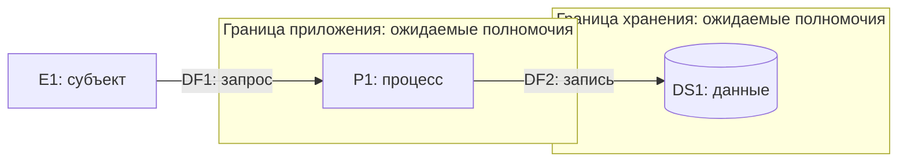

# Модель угроз: <система или изменение>

Дата: <дата>. Версия: <версия>. Автор: <автор>.
Входы: <описание, схема, версия кода, наблюдения>.
Граница проверки: <что сверено с системой, что известно только из описания>.

Заполни поля по основаниям. Неизвестное обозначай явно. Формат проекта может
заменить эту форму при сохранении сведений и связей. Пример диаграммы ниже
задаёт только обозначения, его состав не является моделью целевой системы.

## Область

- Цель: <какое решение поддерживает модель>.
- В области: <компоненты, сценарии, активы>.
- Вне области: <границы и причина>.
- Метод: <STRIDE, дерево атак или иной выбранный метод>.
- Приватность: <применимые риски и отдельный способ рассмотрения>.
- ИИ: <наличие и предметный охват после применения ait-sec-ai>.

## Нарушители

| ID | Субъект | Доступ и возможности | Цель |
| --- | --- | --- | --- |
| ADV1 | <кто> | <исходные права, ресурсы> | <результат для нарушителя> |

## Элементы и потоки

| ID | Тип и назначение | Актив или данные | Основание |
| --- | --- | --- | --- |
| E1 | <внешняя сущность> | <актив> | <источник> |
| P1 | <процесс> | <актив> | <источник> |
| DS1 | <хранилище> | <данные> | <источник> |
| DF1 | <E1 → P1> | <данные и полномочия> | <источник> |
| DF2 | <P1 → DS1> | <данные и полномочия> | <источник> |

Для каждой границы укажи известные проверки и источник сведений. Большую
диаграмму раздели на обзор и подробные схемы с теми же идентификаторами.

## Допущения

| ID | Допущение | Состояние | Проверка | Зависимые записи |
| --- | --- | --- | --- | --- |
| A1 | <утверждение> | <не проверено> | <свидетельство/план> | <T1, R1> |

Состояния: не проверено, подтверждено, опровергнуто. При изменении A1 укажи
зависимые записи для пересмотра. Отсутствие допущений также обозначь явно.

## Покрытие

Для STRIDE заполни матрицу из договора вывода навыка. Добавь строку для
каждого объекта из перечня элементов и потоков, включая внешние сущности.
В ячейке допустимо несколько ссылок. `Q` обозначает открытый вопрос,
`N` — проверяемое обоснование неприменимости. Ниже только заготовка.

| Объект | S | T | R | I | D | E |
| --- | --- | --- | --- | --- | --- | --- |
| P1 | <T1> | <Q1> | <Q2> | <Q3> | <Q4> | <Q5> |

| ID | Вопрос или обоснование | Свидетельство либо способ проверки |
| --- | --- | --- |
| Q1 | <что неизвестно> | <как выяснить> |
| N1 | <почему неприменимо> | <проверенное основание> |

Для другого метода используй строки «объект — проверка метода — результат —
основание или следующий шаг» без принудительного STRIDE. Процедура:
[покрытие][coverage].

## Угрозы

| ID | Объект | Метод/категория | Нарушитель | Допущения |
| --- | --- | --- | --- | --- |
| T1 | <P1, DF1> | <STRIDE-S/путь> | <ADV1> | <A1 либо нет> |

### T1. <Название угрозы>

- Предпосылка и действие: <что может сделать нарушитель>.
- Последствие для актива: <ущерб>.
- Основание: <файл и строка, описание, наблюдение или допущение>.
- Техника библиотеки: <источник, ID, адрес, версия/дата, смысл связи>.
- Состояние поиска: <найдена/нет соответствия/источник недоступен>.
- Состояние угрозы: <открыта/условна/требует пересмотра/вне области>.

Повтори карточку для каждой угрозы. Отсутствие техники не удаляет угрозу.

### Переходы многошаговой угрозы

Заполняй только при наличии цепочки. Сохраняй ID угрозы и нумеруй её шаги.
Правила состояний и проверки: [цепочки атак][chains].

- Шаг: <T1/1, исходный объект → следующий объект, поток и граница>.
- Нужно: <субъект, действие, возможности, срок доступа>.
- Доступно: <исходный доступ, предыдущий шаг или A с состоянием проверки>.
- Переход: <механизм и полученная возможность над следующим объектом>.
- Эффект: <объект, хранилище, срок, основание сохранения или вопрос>.
- Основание: <источник, вид свидетельства, версия и граница проверки>.
- Состояние: <обоснован в модели / условен / опровергнут в области>.
- Связи: <R, M, A, Q и нужная проверка>.

Повтори для каждого перехода. Неизвестное звено делает зависимый путь
условным. Опровержение одного пути не закрывает альтернативы.

## Риски

| ID | Угрозы | Приоритет и основание | Владелец | Состояние |
| --- | --- | --- | --- | --- |
| R1 | <T1> | <приоритет> | <имя/роль либо не назначен> | <открыт> |

Имя или роль владельца указывай только по подтверждённому назначению.

### R1. <Название риска>

- Текущая оценка: <способ проекта, основания, неопределённость>.
- Предложенная реакция: <избежать, снизить, принять, передать или иной выбор>.
- Меры: <M1 либо причина отсутствия меры>.
- Остаточный риск сейчас: <оценка с учётом проверенных мер>.
- Прогноз после предложенных мер: <оценка и условия, отдельно от текущей>.
- Решение о принятии: <кто, дата и ссылка либо решения нет>.

Повтори карточку для каждого риска. Если задана числовая шкала, сохрани её,
обоснуй обе оси оценки и проверь расчёт. Не вводи шкалу без основания проекта.
Реакция «принять» становится выбранной только после решения человека.
Без свидетельства решения она остаётся предложением.

## Меры

| ID | Риски | Действие | Состояние |
| --- | --- | --- | --- |
| M1 | <R1> | <конкретная мера> | <предложена> |

### M1. <Название меры>

- Действие и ожидаемое свойство защиты: <что изменится>.
- Исполнитель: <подтверждённое назначение либо не назначен>.
- Реализация: <свидетельство либо не подтверждена>.
- Проверка результативности: <критерий, тест, результат либо не выполнена>.
- Ограничения: <что мера не закрывает>.

Повтори карточку для каждой меры. Состояния: предложена, реализована
(есть свидетельство), проверена (есть результат проверки). Неудачная проверка
остаётся явным результатом, а не отметкой о подтверждённой защите.

## Итог и следующие действия

- Главные риски: <приоритет и обоснование>.
- Полнота покрытия: <завершено либо не завершено, причины и ссылки>.
- Объекты без строки покрытия: <число и ID из перечня объектов>.
- Незаполненные проверки: <число и пары объект/проверка>.
- Открытые вопросы: <число уникальных Q, ссылки и следующие проверки>.
- Угрозы и риски: <числа>. Меры: <числа по состояниям>.
- Пересмотр: <изменения допущений, архитектуры и входов>.
- Следующие действия: <меры, проверки и решения человека>.

Покрытие завершено только при отсутствии пропущенных применимых проверок
и открытых вопросов. Иначе укажи «не завершено».

[coverage]: ../references/coverage-and-traceability.md
[chains]: ../references/attack-chains.md
